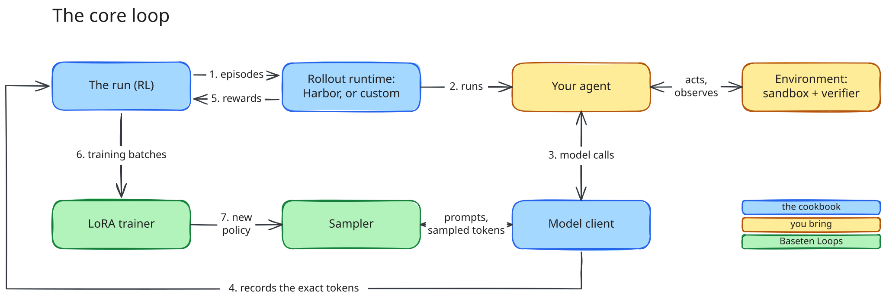

# loops-cookbook

Post-train models on [Baseten Loops](https://docs.baseten.co). Loops runs the
expensive half, a LoRA trainer and a paired sampler that hot-swaps to each new policy;
the cookbook runs the rest. It comes with two recipes, and the `loops` command runs
both: each config names its recipe with the `recipe` key.

| Recipe | Config key | Use it when |
| --- | --- | --- |
| [RL](#rl) | `recipe = "rl"` | your agent acts on tasks and a verifier rewards what it did |
| [SFT](#sft) | `recipe = "sft"` | you have conversations for the model to imitate |

## Install

You need `uv`, and a Baseten workspace with Loops enabled and its API key. Gated or
private Hugging Face repos, including a tokenizer named by `[model] tokenizer`, also
need `HF_TOKEN`.

As a dependency of your own project, from [PyPI](https://pypi.org/p/baseten-loops-cookbook).
Add `==X.Y.Z` to pin a [release](https://github.com/basetenlabs/loops-cookbook/releases).

```sh
uv add baseten-loops-cookbook             # SFT, or RL with a custom runtime
uv add "baseten-loops-cookbook[harbor]"   # RL with the Harbor runtime
```

The package ships the [examples](examples/), [patterns](patterns/) and [tasks](tasks/).
Run one by its path in this repository, from any directory:

```sh
uv run loops check examples/terminal_bench/train.toml
```

A file at that path in your working directory wins over the installed one, so to change
an example, copy its directory there; `loops check` prints where the installed one is.
Copy it too for an example whose scripts write beside themselves, such as `sft_toucan`. The extras are the same as below: for
example, `uv add "baseten-loops-cookbook[harbor-blaxel]"`.

Or clone it to run the examples and hack on it:

```sh
uv sync                         # the core: SFT, and RL with a custom runtime
uv sync --extra harbor          # + the Harbor runtime on Docker
uv sync --extra harbor-blaxel   # + the Harbor runtime on Blaxel sandboxes
uv sync --extra harbor-daytona  # + the Harbor runtime on Daytona sandboxes
uv sync --extra blaxel          # + the Blaxel provider alone, for a custom runtime (likewise daytona)
uv sync --extra wandb           # mirror metrics to Weights & Biases
uv sync --extra console         # the rich live progress region (--output.console)
uv sync --extra vision          # image inputs for vision models (brings torch)
uv sync --extra custom-loss     # RL: your own loss through forward_backward_custom (brings torch)
```

The cookbook reaches Loops through the
[`baseten-loops`](https://pypi.org/project/baseten-loops/) SDK, which it installs.
Copy [.env.example](.env.example) to `.env` and fill in `BASETEN_API_KEY`. The CLIs
load `.env` from the training config's directory or the working directory. Loops itself
needs nothing local: the trainer and sampler run on Baseten.

## Serverless or dedicated

Loops runs each model in one of two ways:

- **Serverless.** The run trains and samples on a shared pool that Baseten keeps
  ready, so the run starts in minutes.
- **Dedicated.** The run gets its own trainer and sampler deployment. This takes
  longer to start. The deployment stays provisioned, and you pay for it, until
  the run is deactivated. `loops run` leaves it up on exit, so a later run can reuse
  it. Set `[compute] keep_run = false` to deactivate it on exit, or run `loops
  deactivate <run id>` later.

Every config chooses one: `[compute] scope = "serverless"` or `"dedicated"`. Which
models have a serverless pool depends on Loops and your workspace; a serverless run
of a model or configuration the pool cannot take fails when Loops creates it, never
falling back to a billed deployment. Settings that size a deployment (replicas, spot,
reuse) are dedicated only, and `loops check` refuses them on a serverless run. The
quickstarts below train Qwen/Qwen3.6-35B-A3B on serverless.
Some patterns and examples train other models. The
[examples table](examples/README.md) gives the model of each example and how that
model runs.

> [!NOTE]
> Contact Baseten to get access to a serverless pool, to train a model that has no
> pool, or to get dedicated capacity.

## RL

Loops trains on what your agent did; the cookbook runs your agent on your tasks and
turns each episode into training data with the exact tokens the model sampled.

### How it works

<picture>
  <source media="(prefers-color-scheme: dark)" srcset="docs/assets/core-loop-dark.svg">
  
</picture>

1. The **run** schedules episodes on the **runtime** (Harbor, or a custom runtime).
2. The runtime runs your **agent** in its environment.
3. Every model call the agent makes goes through the cookbook's **model client** to the
   sampler.
4. The model client records the exact tokens the sampler returned.
5. The environment's verifier scores the episode, and the reward comes back through
   the runtime.
6. The run joins tokens and rewards into training batches for the LoRA trainer.
7. The trainer publishes the new policy to the sampler, and the next episodes use it.

So the responsibilities split cleanly:

- **You bring** an environment (tasks, sandboxes, a verifier that produces rewards)
  and an agent that decides what to do in it. The agent owns its prompts, tools,
  history, and stopping rules.
- **The cookbook brings** the model client, which renders messages with the model's
  own chat template and keeps the exact token IDs and logprobs; rollout scheduling
  across sampling and grading, sync or async; GRPO advantages (reward minus the group
  mean, not divided by its standard deviation) and datum packing; the
  Loops trainer transport, checkpoints, and metrics.

### Pick a pattern

Where your agent runs decides most of what you write:

- **in-process**: your agent is Python the runtime calls inside the training process,
  such as a Harbor `LoopsAgent` class. It can call the model directly with `llm()`.
- **local**: your agent is its own program (a binary, a CLI, another language, code
  you can't edit) that the runtime launches on the training machine. It reaches the
  model through the run's OpenAI-compatible endpoint.
- **remote**: your agent runs inside the sandbox, such as an agent installed in the
  environment. Not supported yet.

[patterns/README.md](patterns/README.md) defines the terms, then shows each placement with
a diagram, what you write, when to use it, and who owns the sandbox on each
environment backend. Every supported pattern is a runnable directory in
[patterns/](patterns/), with a training config per backend; [examples/](examples/)
builds settings and features on top of them.

Tasks with an environment also need an environment backend (see
[environment backends](patterns/README.md#environment-backends)): a local Docker daemon
is enough to start, and Blaxel or Daytona needs its extra and its credentials.

### Quickstart

The smallest run needs only the core install and `BASETEN_API_KEY`: no Harbor, Docker
or sandbox.

```sh
uv run loops check patterns/custom_runtime/in_process_direct/train.toml   # resolves the config, asks Loops about the model; launches nothing
uv run loops run   patterns/custom_runtime/in_process_direct/train.toml   # provisions Loops resources (billable)
```

`check` launches no sandbox and no Loops trainer (on a first run it still downloads the
tokenizer and any remote dataset), but it is not read-only: it writes a
fresh run directory under `<output_dir>/preflight/`, with its own resource journal,
and whatever the runtime writes while it prepares.

This is [custom runtime, in-process, direct](patterns/custom_runtime/in_process_direct/):
an `Episode` asks the model to name a hidden game once and scores the reply itself, so
the reward climbs within a few steps. Every training setting can be overridden on the
command line; `loops run --help` lists them with defaults.

With Harbor tasks, start from [Harbor, in-process, direct](patterns/harbor/in_process_direct/)
instead: the same one-call agent, on the shared [hill-climb task](tasks/hill_climb/).
A Harbor trial always starts an environment, for the agent's answer and the verifier,
so even this task runs in a sandbox: `train.toml` on local Docker (`--extra harbor`),
or `train_blaxel.toml` on Blaxel with no Docker (`--extra harbor-blaxel` and Blaxel
credentials). Every other pattern is a directory beside these in [patterns/](patterns/),
and [examples/](examples/) adds settings and features on top.

If a run crashes, the sandboxes it created on Blaxel or Daytona are in its resource
journal, and `cleanup` releases them:

```sh
uv run loops cleanup patterns/harbor/in_process_direct/train_blaxel.toml --state-dir runs/harbor-direct-blaxel/<run-dir>/state
```

Docker sandboxes are Harbor's and not in the journal; after a crashed Docker run, check
`docker ps`.

The training process runs where you start it. It renders every turn's prompt, holds
each live conversation's tokens and opens files and sockets for each live attempt
(`check` refuses an open-file limit too low for them), so its CPU, memory and open
files grow with `max_concurrent_rollouts` and context length. A laptop
is enough for the patterns here; for high concurrency with long contexts, or a run that
must outlast your laptop, start it on a dev box.

## SFT

Supervised fine-tuning needs no runtime, pattern or sandbox: only your data and a
Loops trainer.

### Quickstart

```sh
uv run loops check examples/sft_tool_use/sft.toml   # renders every row; launches nothing
uv run loops run   examples/sft_tool_use/sft.toml   # provisions a Loops trainer (billable)
```

### Data

Data is OpenAI chat fine-tuning JSONL (`messages`, `tools`, a per-turn `weight`), or
already tokenized `input_ids` and `weights` for full control. Each conversation is
rendered with the trained model's chat template, which decides the targets: every
trained turn learns its own stop token, in the context it was generated in. `check`
reports what trains, what is split per turn and what is refused, with the reason.
[docs/reference/sft.md](docs/reference/sft.md) has the contracts, the rule, the
metrics and resume. [examples/sft_toucan](examples/sft_toucan/) trains on real
tool-agent trajectories from Hugging Face and compares the base model and the adapter
on held-out conversations; [examples/sft_tool_use](examples/sft_tool_use/) is a small
synthetic one.

## Use it as a library

```python
from loops_cookbook.project import load

project = load("train.toml", env_file=".env")
report = await project.check()
print("\n".join(report.describe()))
outcome = await project.train()
```

`load()` reads a TOML or JSON config, and its `recipe` key picks the recipe, as it does
for `loops`. It keeps `project.path`, `project.source` and `project.config`, and makes
the config's directory importable. Pass dotted overrides as
`overrides={"training.max_steps": 5}`. A path in the config is relative to the config.
A symlinked config is the file it points to, so its paths, modules and `.env` are
beside that file. A path in an override, and the output directory, are relative to the
working directory when `load()` runs.

`load()` reads `.env` only when you pass `env_file`, which is relative to the config.
It sets only variables that the process does not set. `loops` always loads `.env`
beside the config and in the working directory, with the same rule.

`loops check` first prints what the config used, and a run's `run.log` begins with
the same lines:

```text
Config: /home/me/project/train.toml -> /home/me/shared/train.toml
  paths, modules: beside /home/me/shared
  .env: /home/me/shared/.env, /home/me/project/.env
  runs: /home/me/project/runs
```

Both operations are async. `check()` does what `loops check` does and returns a report;
`describe()` gives the lines `loops check` prints after those; `project.describe()`
gives those. A check can download model or data
files, and an RL check writes a run under `output_dir/preflight`. It starts no trainer.
`train()` does what `loops run` does and returns the run's `Outcome`. The library
does not configure logging; that stays with your application. For custom wiring, use
each recipe's `recipe.train` and `recipe.check` directly.

- `loops_cookbook.runtime`: the `RolloutRuntime` contract a runtime implements, and
  the attempt and evidence types it receives. `[runtime].factory` names the
  runtime's factory.
- `loops_cookbook.model_access`: attempt leases, capture, `ModelAccessMode`, and the
  OpenAI-compatible gateway for agents that speak Chat Completions (a runtime whose
  model access is `openai_http`).
- `loops_cookbook.rl`: the RL recipe. Its core is environment-agnostic: `Run`,
  `Pipeline`, `Trainer`, GRPO. `rl.cli` and `rl.recipe` are the composition roots that
  wire it to a runtime and providers, as `sft.cli` and `sft.recipe` are for SFT.
- `loops_cookbook.llm`: `LoopsLLM`, the handle a runtime's agents call the model
  through, the model client, and the Prime renderer adapter.
- `loops_cookbook.resources` and `loops_cookbook.providers`: the provider-neutral
  resource registry and journal behind `attempt.services.resources`, and the
  `[providers.<name>]` adapters it acts through.
- `loops_cookbook.harbor`: Harbor as one runtime among others. `create_runtime`
  and `LoopsAgent`.
- `loops_cookbook.sft`: supervised fine-tuning. Its core is its data contracts, the
  target rule and `Run`; `sft.cli` and `sft.recipe` are its composition roots, and
  `sft.recipe.train` is the entry point `loops run` calls.

Each name is imported from the one package that defines it.

A custom runtime is an `Episode` class (`loops_cookbook.episodes`), which the cookbook
runs as a `RolloutRuntime` and which reuses everything else;
[patterns/custom_runtime](patterns/custom_runtime/) has one for each supported agent
placement and model access, the smallest being
[in_process_direct](patterns/custom_runtime/in_process_direct/).

## Docs

- [patterns/README.md](patterns/README.md): every pattern, with diagrams, what you write,
  and when to use it; environment backends.
- [examples/README.md](examples/README.md): examples by setting and feature, built on
  the patterns.
- [docs/reference/](docs/reference/README.md): the exact rules: the training loop,
  model access and token capture, scheduling, resources, failures, the `Episode` API,
  Harbor, Daytona, renderers, SFT, and every setting
  ([KNOB_GLOSSARY.md](docs/reference/KNOB_GLOSSARY.md)).
- [docs/README.md](docs/README.md): how the cookbook is built, for developers changing
  it: the principles, the engine, the interfaces, and the patterns' mechanics.
- [tests/README.md](tests/README.md): the test layout and the live tests.
- [ROADMAP.md](ROADMAP.md).

## Contributing

Setting up, running the tests and cutting a release: [CONTRIBUTING.md](CONTRIBUTING.md).
