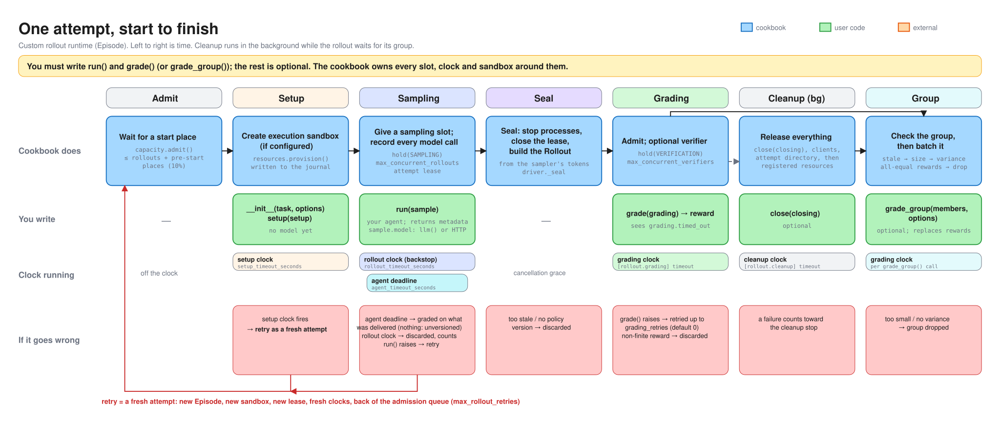
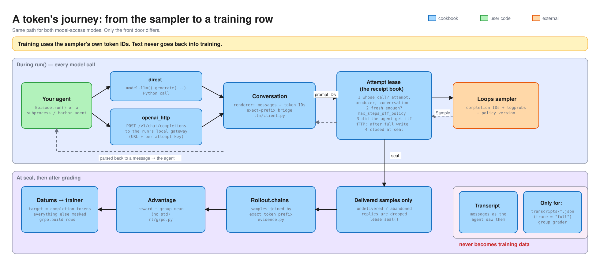
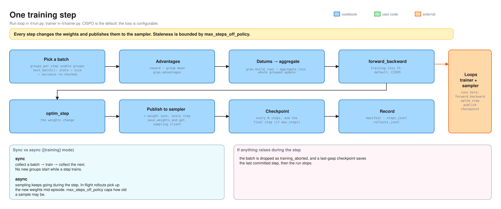

# 1 · The training engine

This page is for engineers who change the cookbook. It explains how one run works
inside, the rules the code keeps, and why. To use the cookbook, read the
[README](../README.md) and [patterns/](../patterns/).

<picture>
  <source media="(prefers-color-scheme: dark)" srcset="assets/engine-overview-dark.svg">
  
</picture>

## The idea

A run does reinforcement learning (RL) on agents. For each task, it samples a group of
attempts against the live policy and scores them. It turns each group's rewards into
advantages, and it trains one step on Loops.

In the diagram, the engine is everything in blue. It schedules attempts, runs every
clock and retry, and owns every billed sandbox. Above all, it records the exact tokens
that the sampler produced, so training never depends on text. Everything else in the
engine serves that.

A **rollout runtime** runs the episode itself. The engine calls it through a
contract of six methods, plus an optional group grader, and never trusts it for
evidence. What an episode *means*, such as its reward and what a failure scores, is user
code. The mechanics and the evidence belong to the engine.

## The parts

| Part | File | What it does |
| --- | --- | --- |
| Run | `rl/run.py`, `rl/recipe.py` | It owns the run's lifecycle: preflight, the gateway, the registry, the loop, the shutdown order and resume. `check` stops after preflight. `assemble` in `rl/recipe.py` builds what the run uses, which is the trainer, the rollout runtime's factory and the renderer. |
| Pipeline | `rl/pipeline.py` | It turns the task stream into groups, runs the sampling, grading and group-grading workers, gates admission in sync and async mode, and selects batches. It only schedules. |
| AttemptDriver | `runtime/driver.py` | It runs one attempt's lifecycle around the rollout runtime's hooks. It owns the clocks, the retries, sealing the `Rollout`, cleanup, and the stop when failures are systemic. |
| RunCapacity | `runtime/capacity.py` | It owns the admission queue and its pre-start places, the sampling and verification permits, and the bookkeeping for the clocks. |
| Model access | `model_access/`, `llm/` | It owns the per-attempt **lease**, which keeps a receipt for every model call. It also owns the renderer, the direct client and the HTTP gateway. |
| Trainer | `rl/trainer.py`, `rl/grpo.py` | It computes advantages, builds token-exact training rows, and calls `forward_backward` and `optim_step`. It also publishes the weights and saves checkpoints. |
| ResourceRegistry | `resources/`, `providers/` | It owns every billed resource. It writes each one to its journal first, then creates it, releases it, proves it absent, and recovers it after a crash. |
| Rollout runtime contract | `runtime/api.py` | It defines the six hooks `prepare`, `sample`, `grade`, `finish`, `abort` and `close`. It is the only seam that user code sits behind. See [2 · Interfaces](2-interfaces.md). |

## Scheduling: from a task to a batch

<picture>
  <source media="(prefers-color-scheme: dark)" srcset="assets/scheduling-dark.svg">
  
</picture>

The pipeline (`rl/pipeline.py`) decides *when a group starts*. `RunCapacity`
(`runtime/capacity.py`) decides *when each attempt may take a step*. Together they keep
these rules:

- **One gate starts groups.** In sync mode, the gate admits exactly the
  `groups_per_step` groups that the next step needs, and it admits nothing while a step
  trains. In async mode, it starts a group while the groups that have started but are
  not yet training fit the freshness window. The window works like this:
  - It holds `admission_steps_ahead` batches of groups. When that setting is unset, it
    holds `max_steps_off_policy` batches. Fractions are allowed.
  - When no batch is training, it holds one batch more.
  - It also holds the groups that recent drops say will not train, up to one batch of
    them.
  - Admission counts it in rollouts, so a group that is still filling holds only its
    members that haven't resolved yet.
  - The started groups never outnumber the batch places that `max_steps_off_policy`
    leaves.

  The gate bounds staleness mainly by not starting work, rather than by discarding work
  later.
- **Three limits bound the work.** Each limit is a semaphore.
  `max_concurrent_provisioning` bounds provider operations, `max_concurrent_rollouts`
  bounds agents running, and `max_concurrent_verifiers` bounds graders running. `grade()`
  and the group grader share the verifier limit. Work holds a slot only while it runs. A
  rollout that waits to be graded, or a group that waits for its batch, holds nothing.
- **Admission is one queue, oldest group first.** An attempt is admitted when the number
  of active attempts is under its group's target. Waiting attempts are served in the
  order their groups were dispatched, and a group's own attempts in the order they
  arrived. A retry is a fresh attempt, so it arrives behind newer groups. This order
  keeps it from waiting behind them while its own group waits for it. Once a group has
  started, its siblings always fill up to the full limit, `max_concurrent_rollouts`, so
  a group that has begun always finishes.
- **Pre-start places let a few attempts get ready early.** They let extra attempts
  create their sandbox and run `setup()` before a sampling slot frees. There are
  `ceil(prestart_allowance × max_concurrent_rollouts)` of them. For example, there are 7
  when `max_concurrent_rollouts` is 64 and `prestart_allowance` keeps its default of
  0.1. They apply only on top of the full target, so under
  backpressure no new group starts early.
- **The permits are the limit, not the workers.** The pipeline runs enough sampling,
  grading and group-grading workers that they are never the bottleneck.
- **A group is ready when every rollout in it has resolved**, which means each one was
  graded, failed or was discarded. Batch selection first takes groups held over from a
  batch that needed replacements. Then it takes the ready group closest to going stale.
  That is the group whose oldest member sampled at the lowest policy version, with
  dispatch order breaking ties. Selection never waits for a particular group. It
  rechecks each group's staleness, size and variance. A group needs at least
  `group_size − max_group_losses` members. Selection counts unusable groups toward
  `max_consecutive_unusable_groups`, which defaults to 16.

These tests hold the rules in place:

- `tests/unit/runtime/test_capacity.py` has
  `test_a_prestart_place_never_starts_a_group_the_target_holds_back`,
  `test_a_lower_target_never_interrupts_an_active_rollout_and_started_groups_finish`,
  `test_waiting_attempts_are_admitted_in_arrival_order_and_nobody_jumps_the_queue`,
  `test_a_retried_attempt_of_an_older_group_is_admitted_before_newer_groups` and
  `test_a_group_grader_call_takes_one_of_the_same_verification_slots_as_grade`.
- `tests/unit/rl/test_pipeline.py` has
  `test_sync_admission_stops_across_training_and_publish`,
  `test_async_starts_only_groups_that_can_train_fresh`,
  `test_the_window_admits_exactly_the_groups_expected_to_drop`,
  `test_start_admission_orders_groups_as_they_were_dispatched` and
  `test_the_ready_group_sampled_at_the_oldest_policy_trains_first_and_not_stale`.

The exact rules are in [reference/scheduling.md](reference/scheduling.md) and
[reference/settings-that-interact.md](reference/settings-that-interact.md).

## One attempt

<picture>
  <source media="(prefers-color-scheme: dark)" srcset="assets/story-1-attempt-dark.svg">
  
</picture>

The driver builds the `Rollout`, not the rollout runtime. `sample()` returns only
metadata, as an `EpisodeResult`. When `sample()` returns, the driver seals the attempt,
which closes its record of model calls. To seal, the driver first kills the attempt's
processes. Then it lets model access quiesce, which means model access stops taking new
calls and gives the calls in flight a grace period to finish. Then the driver seals the
lease and builds the `Rollout` from what the lease captured (`runtime/driver.py`,
`_seal`). Grading attaches a reward. `finish()` runs in the background once the graded
rollout has joined its group.

## A token's journey

<picture>
  <source media="(prefers-color-scheme: dark)" srcset="assets/story-2-token-dark.svg">
  
</picture>

## One training step

<picture>
  <source media="(prefers-color-scheme: dark)" srcset="assets/story-3-training-step-dark.svg">
  
</picture>

`Trainer.commit` runs the optimizer step and publishes the new weights.
`Trainer.checkpoint` is a separate call (`rl/trainer.py`). A step counts as soon as its
weights are published, so a checkpoint that fails afterwards loses only its own
artifacts. However the run ends, if the checkpoint cadence skipped the last applied
update, the run saves it (`rl/run.py`, `_last_gasp`).

## The rules the code keeps

A test holds each rule below, and each rule names the code and the tests that hold it.
If you break a rule, its test fails.

1. **Training data is the sampler's own tokens.** Training rows are built only from the
   captured prompt and completion token IDs and log probabilities. Text is never
   re-tokenized. A row's targets cover every text position, so that token provenance can
   check each target against the sampler's record of the tokens. Only the agent's own trainable
   generations, which the row calls its `actions`, train, and each trains once. This
   rule lives in `rl/grpo.py`, and `tests/unit/rl/test_grpo.py` holds it with
   `test_linear_rows_train_each_action_once_with_real_targets` and
   `test_fork_trains_history_once_per_chain`.
2. **Only delivered generations train.** A reply that the agent never fully received is
   dropped at seal, and the rest of the episode trains. Examples are an HTTP write that
   failed, and a request still in flight at seal. This rule lives in
   `model_access/lease.py`, and these tests hold it:
   `test_lease.py::test_a_request_still_in_flight_when_the_attempt_seals_stays_out_of_the_evidence`
   and
   `test_gateway_transcript.py::test_a_turn_whose_delivery_failed_mid_write_is_marked_undelivered`.
3. **The rollout runtime never hands over evidence.** `sample()` returns metadata,
   and the driver builds the `Rollout` from the lease. The contract's signatures and
   fields are frozen. The test is
   `tests/unit/test_contract.py::test_every_runtime_has_exactly_the_normative_signatures_and_nothing_public_besides`.
4. **A cut agent is graded. Only the rollout clock discards.** When the
   rollout runtime's own agent deadline fires, the episode is sealed with what was delivered,
   and then graded with `grading.timed_out` set. If the cut left no delivered
   generation, there is nothing to train. The rollout is discarded as `unversioned` and
   counts as a sampling failure, like any rollout without trainable evidence. The
   engine's rollout clock, `rollout_timeout_seconds`, is a backstop. When it fires, the
   rollout is discarded as `agent_timeout/rollout_clock`. The discard counts as a
   sampling failure toward `max_consecutive_rollout_failures`, the limit on consecutive
   failures that stops the run.
   The tests are
   `tests/unit/harbor/test_trials.py::test_an_agent_deadline_that_cut_its_only_generation_leaves_nothing_to_train`,
   `test_driver.py::test_the_rollout_clock_cancels_sample_and_is_a_non_retried_agent_timeout`
   and `test_driver.py::test_rollout_clock_expiries_between_real_failures_count_toward_the_stop`.
5. **A retry is a fresh attempt, and only a failure that might pass again is
   retried.** A retry gets a new attempt id, new rollout runtime state, a new
   sandbox, a new lease and new clocks. A failure that repeats on every try is tried only
   once. Examples are non-JSON metadata and an undeclared producer. The tests are
   `test_driver.py::test_an_eligible_failure_is_retried_as_a_fresh_attempt_after_cleanup`
   and
   `tests/unit/episodes/test_runtime.py::test_episode_metadata_that_is_not_json_fails_the_rollout_without_a_retry`.
6. **A hook that ignores cancellation is kept, and the run goes on.** Python can't kill
   a coroutine. A hook that outlives its grace keeps its attempt live, with its permits
   and resources, until the hook ends. Its rollout is discarded, or its cleanup is
   counted as failed. The run stops when the kept hooks still running pass 5% of
   `max_concurrent_rollouts`, rounded up, or when they hold every slot of a phase or
   every admission place, because then no other rollout can get one. The test is
   `test_driver.py::test_a_finish_that_ignores_cancellation_is_a_cleanup_failure_and_the_run_goes_on`.
7. **Staleness is bounded everywhere.** `max_steps_off_policy` is checked as samples
   arrive, before grading, before the group grader runs and at batch selection. A sample
   from a *newer* policy than the trainer's is fatal. The tests are
   `test_lease.py::test_freshness_is_enforced_during_the_episode`,
   `test_lease.py::test_a_future_policy_version_is_fatal_to_the_run` and
   `test_pipeline.py::test_refresh_filters_stale_members_and_preserves_fresh_siblings`.
8. **A step counts once it is published.** The tests are
   `tests/unit/rl/test_run.py::test_a_checkpoint_that_fails_after_publication_leaves_the_step_trained_and_resumable`
   and
   `tests/unit/rl/test_run.py::test_an_open_ended_run_that_stops_while_collecting_keeps_its_last_update`.
9. **Every billed resource is written down before it exists.** The registry fsyncs a
   creation intent to its journal before any provider call, and it records the outcome
   afterwards. After a crash, the registry recovers from the journal. The test is
   `tests/unit/resources/test_registry_recovery.py::test_a_crash_after_intent_recovers_by_reconciling_the_identity`.
10. **A create that the provider turns away is sent again. A create that may already
    exist never is.** A refusal, such as Blaxel's `429` or a request that never reached
    the provider, left nothing behind. So the registry waits and sends the same create
    again, within the create's one deadline. The wait starts at 1 s and doubles up to
    30 s, with jitter, and it holds no permit.

    The registry also limits how many of a provider's creates are in flight at once.
    That limit is a window:
    - The window halves on a refusal, but only once per burst of refusals.
    - It grows by about one for each window's worth of creates answered without a
      refusal. A failure or a timeout also counts as an answer without a refusal.
    - It starts at `max_concurrent_provisioning`, which is also its cap, and it never
      goes below 1. A fractional size rounds up to the next whole slot.
    - Creates wait for a slot in the order they first asked, and they hold no permit
      while they wait.

    A wait before a create's first send costs none of its deadline. A stop during
    either wait ends the create as never created. These tests in
    `test_registry_backoff.py` hold the rule:
    `test_a_refused_create_is_sent_again_after_a_growing_wait`,
    `test_a_burst_into_a_shared_limit_converges_to_the_room_left`,
    `test_the_window_narrows_as_others_load_rises_and_recovers_once_it_falls`,
    `test_one_burst_of_refusals_halves_the_window_once`,
    `test_a_halved_window_of_three_still_sends_two_creates_at_once`,
    `test_answers_that_are_not_refusals_widen_a_narrowed_window_back_to_its_cap`,
    `test_a_create_waiting_longest_is_sent_first_and_a_retry_keeps_its_place`,
    `test_a_stop_during_a_wait_ends_it_at_once_as_never_created`,
    `test_a_stop_while_a_create_waits_for_a_slot_sends_nothing`,
    `test_every_try_of_a_refused_create_shares_its_one_deadline` and
    `test_a_wait_for_a_slot_before_the_first_send_costs_none_of_the_deadline`. So does
    `tests/unit/providers/test_adapter_contract.py::test_a_create_the_provider_turns_away_for_now_is_sent_again`.
11. **The packages are layered.** These import rules hold:
    - The core packages import no Harbor or provider code. They are `evidence`, `llm`,
      `model_access`, `runtime`, `rl`, `sft` and the shared modules.
    - Only a recipe's composition roots import that code. They are `rl/cli.py`,
      `rl/recipe.py` and SFT's, plus the two modules that wire every recipe,
      `command.py` and `project.py`.
    - The two recipes share only common modules.
    - There are no package cycles.
    - Code reaches Harbor's private members only through `harbor/integration.py`,
      `harbor/blaxel.py` and `harbor/daytona.py`.
    - Only `providers/<provider>` imports that provider's SDK.
    - Public contracts contain no `Any`.

    The tests are `tests/unit/test_architecture.py` and
    `tests/unit/test_contract.py::test_the_public_contracts_contain_no_any`.

## Decisions, and why

| Decision | Why | Rejected |
| --- | --- | --- |
| **Meaning is user code, and the engine reports facts.** There are no settings for what a timeout, an error or a broken sandbox scores. | Each such setting was a silent contract that users couldn't see. The same failure means different things for different tasks. | The settings `on_agent_timeout` and `train_on_infrastructure`, which were built and then deleted. |
| **Evidence comes from the lease, not from the rollout runtime.** | A rollout runtime, or a black-box agent over HTTP, can't be trusted to report tokens exactly. The engine can. | A rollout runtime that returns a `Rollout`. |
| **Retries are opt-in and fresh.** `max_rollout_retries` and the rollout runtime's `grading_retries` default to 0. There is no failure classifier. Raising a `Permanent*Failure` opts out of retries. | A retried attempt must not mix its samples with the failed attempt's. Classifying a failure by its message or type name is guessing. | Retries in place, and error classes matched by string. |
| **The rollout clock is a derived backstop.** For an `Episode`, it is the agent timeout, plus the kill grace, plus 5 s for the process group to exit, plus the cancellation grace (`episodes/runtime.py`). The Harbor rollout runtime and hand-written rollout runtimes derive none, so a config that uses them must set `rollout_timeout_seconds`. | The agent's deadline is the meaningful one. A clock that you have to keep above it by hand drifts. | A required clock that you set by hand. |
| **Deadlines for mechanics have defaults, and deadlines that carry meaning don't.** Cleanup defaults to 600 s, the cancellation grace to 5 s and the kill grace to 10 s. The setup deadline and the Blaxel time-to-live (TTL) stay required. | A setting should exist only for what the cookbook itself does, and it should state its default. | Seven required deadlines. |
| **State it once.** `model_access` and grading retries come from the rollout runtime. The Blaxel region comes only from `[providers.blaxel]`. `check` refuses a config that states the model access or the region again, and the config has no setting for grading retries. | A fact stated twice drifts, and then fails at run time. | A fact stated as both a class attribute and a TOML key. |
| **The engine owns every billed sandbox.** It journals each one, and `loops cleanup` releases leftovers from the journal or by a sweep for the run's labels. | A crash must never lose track of something that bills. Sandboxes also carry a required TTL as the last backstop. | Leaving sandboxes to Harbor or to the user. |
| **Bound staleness at admission.** Async starts a group only while the groups that have started and aren't yet training fit in `admission_steps_ahead` batches, plus the share that recent drops say will not train. `admission_steps_ahead` is at most `max_steps_off_policy`, and defaults to it. | Not starting work is cheaper than sampling it and then discarding it as stale. Admitting fewer batches ahead than the cap lowers lag, and it doesn't drop the long rollouts that a tighter cap would. | Sampling flat out and filtering at the batch. One setting for both the cap and the window. |
| **The registry retries a refused create.** | Blaxel's `429` is a limit on concurrent creates for the whole workspace, shared with every other client, so no cap in the cookbook can avoid it. Only the registry knows that nothing is in flight while it waits, so a stop can end the wait at once. | Retrying in the Blaxel adapter, where a stop would have to wait out the backoff. Leaving it to `max_rollout_retries`, which is 0 by default, so the rollout was discarded. |
| **Each provider has a create window, like TCP's congestion window.** The number of creates in flight halves on a refusal, and grows by about one per window of answers that are not refusals, up to `max_concurrent_provisioning`. Image builds share the window, because Blaxel has one limit for both. | Blaxel's room changes with other teams' load, and refusals are nearly constant, so the rate has to follow them. With a backoff per create, about 58 creates at startup retried into the limit independently. Each was refused 9 to 12 times, and 18 gave up. | Each create backing off on its own, which makes a thundering herd. A shared gate that closes on a refusal. Under that load the gate was closed most of the time, and the backlog rushed in whenever it opened. |
| **Slots measure work, not waiting.** Nothing holds a slot while it queues. | Otherwise a rollout waiting to be graded would block agents from running. | A slot per rollout, from start to finish. |
| **Pre-start places apply only on top of the full target.** | Sandbox start-up overlaps the previous agent's run. Under backpressure, a pre-start place must not start a group that the target held back. | Unbounded pre-start. Pre-start on a lowered target, which was an earlier bug. |
| **Weights are published every step, and nothing that blocks goes on the publish path.** | The sampler must see the new policy, and any wait on that path stalls every rollout. | Readiness checks during weight sync. |
| **The advantage is the reward minus the group mean, and the loss is a setting.** | This follows group relative policy optimization (GRPO), without dividing by the standard deviation. `loss_fn` and `loss_fn_config` are the SDK's. `loss_fn` is one of Loops' policy losses, which are `cispo`, `importance_sampling`, `ppo`, `dro` and `dppo`. The config must name one, because `loss_fn` has no default. It can also be `custom`, which runs through `forward_backward_custom`. A custom loss is scored at every text position, so it can use tool results. | A loss as a new recipe. A datum flag per loss. |

## Where to look first

| Question | Start at |
| --- | --- |
| Why was this rollout discarded? | Read the rollout's `cause` in `rollouts.jsonl`, which has the form `<reason>/<sub_reason>`. The reasons are the `Discard` values in `runtime/driver.py`, and `sub_reason` carries the failure's name. |
| How many attempts run at once? | Read [Scheduling](#scheduling-from-a-task-to-a-batch) above, then `RunCapacity` in `runtime/capacity.py` and `Pipeline._window` in `rl/pipeline.py`. |
| What exactly trained? | Read `build_rows` in `rl/grpo.py`. With `trace = "full"`, the run also writes the rows to `batches/step-N.json`. |
| How does a token get captured? | Read `model_access/lease.py`, and `Conversation` in `llm/client.py`. |
| What does shutdown do, and in what order? | Read `execute` and `_last_gasp` in `rl/run.py`. |

## Changing it safely

- The `test` job in `.github/workflows/ci.yml` runs these gates:
  ```sh
  uv sync --locked --extra harbor-blaxel --extra harbor-daytona --extra wandb
  uv run python scripts/generate_openai_models.py --check
  uv run ruff check src tests patterns examples tasks scripts
  uv run ruff format --check src tests patterns examples tasks scripts
  uv run pyright
  uv run pytest -q
  ```
  The job passes `--durations=30` to pytest, so that a slow test shows when it lands.
  Three more jobs run beside it:
  - The `package` job builds the wheel and the sdist, and checks their metadata with
    `twine check --strict`. Then it installs the wheel in an empty directory and runs
    `loops check` on a bundled pattern, which proves that an install, not only a
    clone, can run an example.
  - The `without-harbor` job installs only `--extra blaxel --extra daytona
    --extra custom-loss`. It checks that Harbor isn't installed, and then runs the
    tests. This proves that the core runs without Harbor.
  - The `contracts` job runs `tests/contracts` against real tokenizers and image
    processors, with `--extra vision`.

  The `dependency-ranges` workflow runs each night and with each release. It tests
  the newest versions that the dependency ranges allow, and the floor of each direct
  dependency, such as `transformers`. The `pr-title` workflow checks that a PR's title
  is a Conventional Commit. It only warns.
- Give every behaviour change a test that fails first. Then check the test by
  mutation. Revert the fix, and watch the test fail.
- Anything on the generation path or the publish path touches every rollout of every
  run. Before you add a mechanism, look for the one that should already cover the case.
- When you add a model, check how its turns end. If a caller passes `stop` as
  *strings*, those strings replace the renderer's end-of-turn stop IDs, because one
  request carries either IDs or strings, not both. That is safe only while the sampler
  still ends the turn at the model's own end-of-sequence (EOS) token. A live test showed
  this for Qwen3.6. With a caller's stop strings set, every generation ended on its
  end-of-turn token. Probe a new model the same way. GLM-5.3 hasn't been probed.

## Known gaps

These gaps don't block anything. They are written down so that nobody has to
rediscover them.

- A clean Ctrl-C doesn't print whether cleanup finished.
- Harbor environment starts can time out under heavy provisioning load, even though
  `check` accepted their time bound.
- A direct call that passes its own trajectory budget above `max_seq_len` can build a
  datum that the trainer refuses, and that fails the run.

## Read next

- [The reference pages](reference/) describe how each piece behaves in detail.
- [The knob glossary](reference/KNOB_GLOSSARY.md) lists every setting.
- [2 · Interfaces](2-interfaces.md) explains how users plug in an environment and an
  agent.
- [3 · Patterns](3-patterns.md) explains agent placement, model access and env
  backends.
- [4 · The SFT recipe](4-sft.md) explains the second recipe, which shares this page's
  CI gates.
