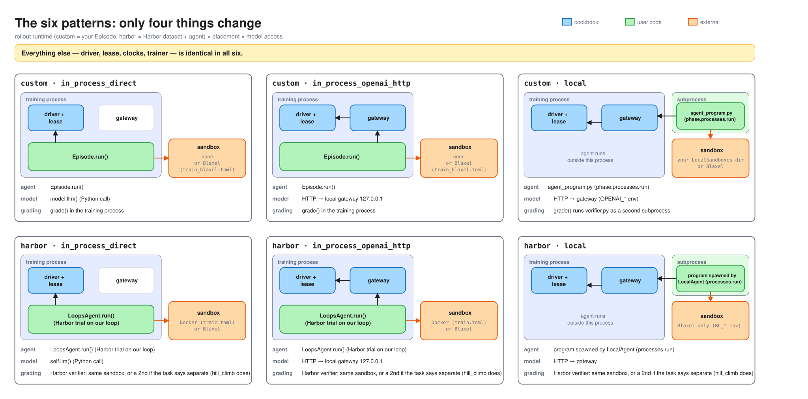
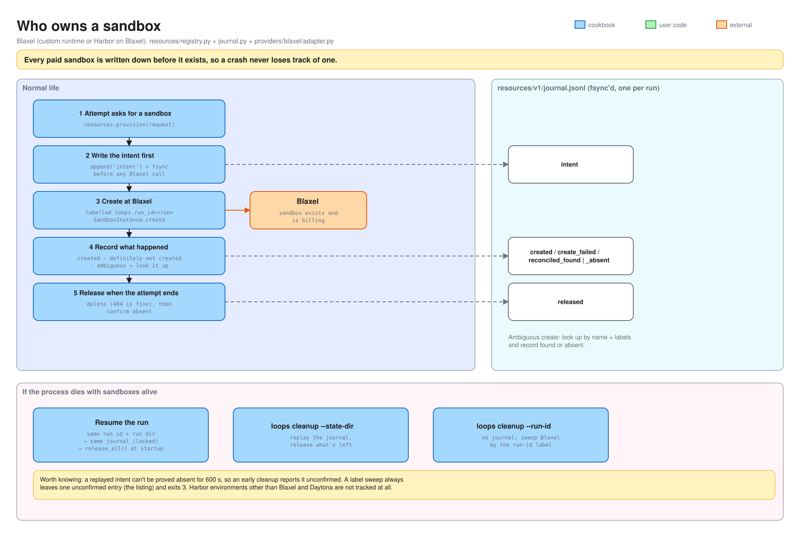

# 3 · Patterns

For engineers changing the cookbook. How the three axes a user picks — where the agent
runs, how it reaches the model, where its commands run — work mechanically, and why.
Choosing a pattern as a user is in [patterns/](../patterns/).

<picture>
  <source media="(prefers-color-scheme: dark)" srcset="assets/story-4-patterns-dark.svg">
  
</picture>

## The idea

A **pattern** is rollout runtime × agent placement × model access, and one copyable directory
in `patterns/<runtime>/` (`in_process_direct`, `in_process_openai_http`, `local`) with one `train_<backend>.toml` per
environment backend, all on the shared tasks in `tasks/`. Only four things change
between patterns: where the agent runs, how it reaches the model, where the sandbox
is, and where grading runs. The driver, the lease, the clocks and the trainer are the
same code in all six. Each pattern runs end to end in CI against faked Loops and Blaxel (`tests/patterns/`), and
every shipped config must pass `check` (`tests/test_shipped_configs.py`).

## Agent placement

| Placement | Mechanics | Code |
| --- | --- | --- |
| **in-process** | The agent is a coroutine on the training process's one event loop. Deadlines cancel it cooperatively, so a blocking call freezes the whole run, and a hook that won't stop stops the run (doc 1, rule 6). | `episodes/api.py` (`AgentTurn`), `harbor/runtime.py` |
| **local** | Another program on the training machine, started through the attempt's `AttemptProcessSupervisor`: its own process group, stdin closed, an environment of a short allowlist plus exactly what the rollout runtime passes, `SecretStr` values redacted from kept output. Cancelling ends the group: `SIGTERM`, `process_kill_grace_seconds`, `SIGKILL`, then a 5 s wait. A nonzero exit is returned, not raised. No process starts once a hook is being stopped or the attempt has ended. | `runtime/processes.py` |
| **remote** | Inside the sandbox. **Not supported.** The gateway listens on the training machine's loopback by default; a sandbox — Docker included, whose loopback isn't the host's — can't reach it. | `[rollout_runtime.openai]` `bind`, `advertised_base_url` |

A local program is trusted: it receives the provider's usage environment, and for Blaxel
that carries the workspace-wide `BL_API_KEY`. The cookbook never has it create or
delete a sandbox, but does not prevent it.

## Model access

| Mode | Mechanics | Code |
| --- | --- | --- |
| **`direct`** | `model.llm(producer)` returns a `LoopsLLM` locked to the attempt's lease and that producer. A generation is delivered when it returns to the caller. In-process only. | `llm/client.py`, `model_access/lease.py` |
| **`openai_http`** | One gateway per run (aiohttp), listening on first use. `http_connection(producer)` hands out a base URL, a key bound to that attempt and producer, and the model name; the key is revoked at seal or abort. Each request renders, samples and records through the same `Conversation` path as `direct`. A reply counts as delivered only once fully written. | `model_access/openai/` |

What the HTTP path adds, and why:

- **`X-Loops-Conversation-Id`** keeps the exact-prefix bridge across requests; without
  it every request is its own conversation. Nothing is lost either way: chains link by
  token prefix, not by id.
- **Refuse, never ignore.** A field the gateway can't honour (`logprobs`, `n > 1`,
  constrained tool choice, remote image URLs) is refused before
  sampling, by name.
- **`Idempotency-Key`** replays a response instead of sampling again, so a client retry
  can't double-sample; `POST /v1/loops/discard` removes a delivered turn from the
  evidence.
- A malformed tool call is the model's output: `422 model_output_invalid`, and it
  trains unless discarded. Echo its `error.reply` and answer the calls to carry on from
  the exact sampled tokens; a request that cannot extend them is refused
  ([model-access.md](reference/model-access.md)).

## Environment backends

<picture>
  <source media="(prefers-color-scheme: dark)" srcset="assets/story-5-sandbox-dark.svg">
  
</picture>

| Backend | Created and deleted by | Tracked | Used by |
| --- | --- | --- | --- |
| none | — | — | custom in-process `train.toml` |
| local directory | the run, through a user-written provider (`patterns/custom_runtime/local/local_sandbox.py`) | journal | custom local `train.toml` |
| Docker | Harbor | **no** | Harbor `train.toml` |
| Blaxel | the run, through `providers/blaxel` | journal | every `train_blaxel.toml` |
| Daytona | the run, through `providers/daytona` | journal | no shipped pattern ([reference/daytona.md](reference/daytona.md)) |
| other Harbor providers | Harbor | **no** | untested |

A provider is a `ResourceAdapter` (`resources/api.py`): create, reconcile, release,
confirm absent and a paged listing, each with a finite deadline. A create it turns away
for now, as a rate limit does, raises `ProvisioningFailure(..., refused=True)`, and the
registry sends it again, while fewer of that provider's creates are sent at once. One that can back an
Episode's sandbox is also a `SandboxProvider` with a typed `SandboxKind`. Blaxel and
Daytona are built in (`providers/__init__.py`, `BUILT_IN`); any other names its factory with
`adapter = "module:callable"` in its `[providers.<name>]` table. Credentials come from
the environment, never the table. Harbor on Blaxel uses the cookbook's
`loops_cookbook.harbor.blaxel:BlaxelEnvironment`, and on Daytona
`loops_cookbook.harbor.daytona:DaytonaEnvironment`, named by `environment.import_path`
alone, so Harbor's sandboxes go through the same registry.

## The rules the code keeps

1. **A local program gets only what it is given.** —
   `tests/unit/runtime/test_processes.py::test_the_environment_is_the_allowlist_plus_exactly_the_commands`,
   `::test_a_secret_never_reaches_argv_output_or_logs`.
2. **A local program never outlives its phase.** —
   `test_processes.py::test_cancelling_run_ends_the_whole_group_before_it_returns`.
3. **An HTTP key is one attempt and one producer, and dies at seal.** —
   `tests/unit/model_access/test_gateway_delivery.py::test_a_credentials_producer_cannot_be_changed_by_the_request`,
   `::test_a_credential_admits_nothing_after_seal_abort_or_gateway_close`.
4. **A mode offers only itself.** A `direct` rollout runtime can't open HTTP and vice versa. —
   `test_gateway_serving.py::test_asking_http_access_for_a_client_states_the_runtimes_mode`,
   `test_lease.py::test_asking_direct_access_for_a_connection_states_the_runtimes_mode`.
5. **Every shipped config passes `check`**, including with every commented setting
   uncommented. — `tests/test_shipped_configs.py::test_the_config_passes_check`,
   `::test_the_config_passes_check_with_every_setting_uncommented`.
6. **Every shipped Blaxel config bounds Blaxel the same way.** —
   `test_shipped_configs.py::test_every_shipped_blaxel_config_bounds_blaxel_the_same_way`.
7. **A provider must page its listing**, so a cleanup sweep is bounded per page. —
   `tests/unit/resources/test_cleanup.py::test_an_adapter_whose_listing_does_not_page_is_refused_when_it_is_created`.

## Decisions, and why

| Decision | Why | Rejected |
| --- | --- | --- |
| **Patterns are directories users copy**, not a framework they configure. | Users read and change the code; duplication inside a pattern is deliberate. | A pattern registry or a base class per pattern. |
| **One task set across patterns.** | Any two patterns of a rollout runtime diff down to the axis that changed. | A task per pattern. |
| **`direct` is in-process only.** | A Python client can't cross a process boundary; everything else speaks HTTP. | A custom RPC for local agents. |
| **OpenAI Chat Completions as the HTTP surface.** | Every agent framework already speaks it; stock clients need nothing special. | A cookbook-specific protocol. |
| **The gateway binds loopback by default.** | Nothing off the machine can reach a credential-bearing endpoint by accident. Remote placement will need an explicit `bind`. | Binding all interfaces. |
| **Local programs are trusted with the provider credential**, documented, not enforced. | Isolation is a separate project; pretending otherwise would be a false guarantee. | A credential proxy. |
| **Docker is Harbor's, untracked.** | Harbor stops its containers; journaling Docker would duplicate Harbor's lifecycle. | A Docker provider. |
| **Examples use SDKs plainly** and handle only observed behaviour. | They are what users copy; defending against unobserved failures is guessing, and the failure contract already retries what raises. | Hardened example agents. |

## Adding one

- **A pattern:** a new directory under `patterns/<runtime>/`, a `train_<backend>.toml`
  per backend it supports, a README, and a test in `tests/patterns/`. It goes into
  `test_shipped_configs.py` automatically.
- **A provider:** implement `ResourceAdapter` (and `SandboxProvider` with a
  `SandboxKind` if Episodes use it), give every operation a finite deadline, page the
  listing, and read credentials from the environment. Only its own package may import
  its SDK (`tests/unit/test_architecture.py`).
- **Remote placement:** needs a reachable gateway (`bind` plus `advertised_base_url`),
  a way to start the agent inside the sandbox, and a decision on how the credential is
  protected there. Not started.

## Known gaps

Remote placement is not supported. Docker and Harbor environments other than Blaxel and
Daytona are not tracked, so a hard kill can leave them behind. Custom local's `train_blaxel.toml` sets
`max_group_losses = 0` and no `max_rollout_retries`, so one lost sandbox loses its group.
