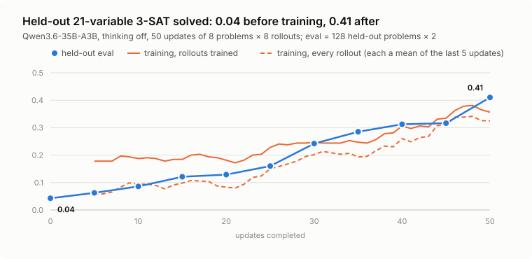

# 3-SAT

In this example, the model learns Boolean satisfiability (SAT). Each problem is a
3-SAT problem of 21 variables and 89 clauses, and each clause has three literals. The
policy works the problem through in its reply, then answers with the variables it sets
to true. The run also evaluates held-out problems while it trains.

The example builds on the
[custom rollout runtime, in-process, direct](../../patterns/custom_runtime/in_process_direct/)
pattern. Each problem takes one model call, and the episode scores it on the host in
microseconds. The problems are hard but learnable. The example needs no sandbox and no
extra.

## Run it

Run these commands from the repository root, with `BASETEN_API_KEY` set in `.env`:

```sh
uv run loops check examples/sat/train.toml
uv run loops run   examples/sat/train.toml
```

`loops check` launches nothing. `loops run` trains on serverless Loops. When the
command exits, it leaves the Loops run up, and it logs the run ID and the
`loops deactivate` command that ends the run.

## How it works

[sat_episode.py](sat_episode.py) is the whole rollout runtime.

- **A task is a seed.** The episode generates the problem from the seed. Each clause
  has three distinct variables, and each variable is negated or not. The generator
  keeps a clause only if a hidden assignment satisfies it, so every problem has a
  solution. The options `variables` and `clause_ratio` set the size. Random 3-SAT is at
  its hardest near 4.26 clauses per variable.
- **The answer is the reply's last line**, such as `True: 3, 8, 14` or `True: none`.
  Anything else scores 0.
- **A reply cut off at `max_generation_tokens` scores 0 and doesn't train.** The episode
  discards it with `conversation.discard(reply)`. Its 0 still counts in the group's
  baseline, but its reasoning isn't pushed down only because it ran out of room.
- **The reward is 1 for an assignment that satisfies every clause**, and 0 otherwise.
  Any satisfying assignment counts, not only the hidden one. The episode's metadata
  keeps the share of clauses that the answer satisfies, as `satisfied`.

[problems.jsonl](problems.jsonl) holds the training seeds, and
[problems_val.jsonl](problems_val.jsonl) holds held-out ones. `[eval.sets.val]` scores
the held-out problems every 5 updates, before the first update and after the last. See
[evals](../../docs/reference/training.md#evals). The run is async, because replies vary
in length, and an async run doesn't make each update wait for the slowest reply.

## Picking the problem size

This sweep ran base Qwen3.6-35B-A3B over several problem sizes, on 24 problems with 8
samples each, with thinking off:

| variables | 12 | 15 | 18 | 21 | 25 |
|---|---|---|---|---|---|
| pass@1 | 0.49 | 0.36 | 0.09 | 0.11 | 0.03 |
| pass@8 | 1.00 | 0.92 | 0.46 | 0.67 | 0.17 |

At 21 variables, the model rarely solves a problem on one try, but it usually does
within eight. So most groups of 8 have both a success and a failure to learn from.

Thinking is off, with `enable_thinking = false`. The policy works the problem in its
reply instead, in about 12k tokens, and ends the reply on its own. With thinking on,
half its replies ran past 32k tokens or ended mid-thought.

## A run

This config ran on serverless Loops. The share of held-out problems solved went from
0.04 before training to 0.41 after 50 updates. The chart shows the training reward in
two ways. `reward/mean_with_unusable` averages over every rollout. `reward/mean`
averages over the rollouts that trained, so it leaves out groups whose rollouts all
scored the same.

<picture>
  <source media="(prefers-color-scheme: dark)" srcset="assets/results-dark.svg">
  
</picture>
