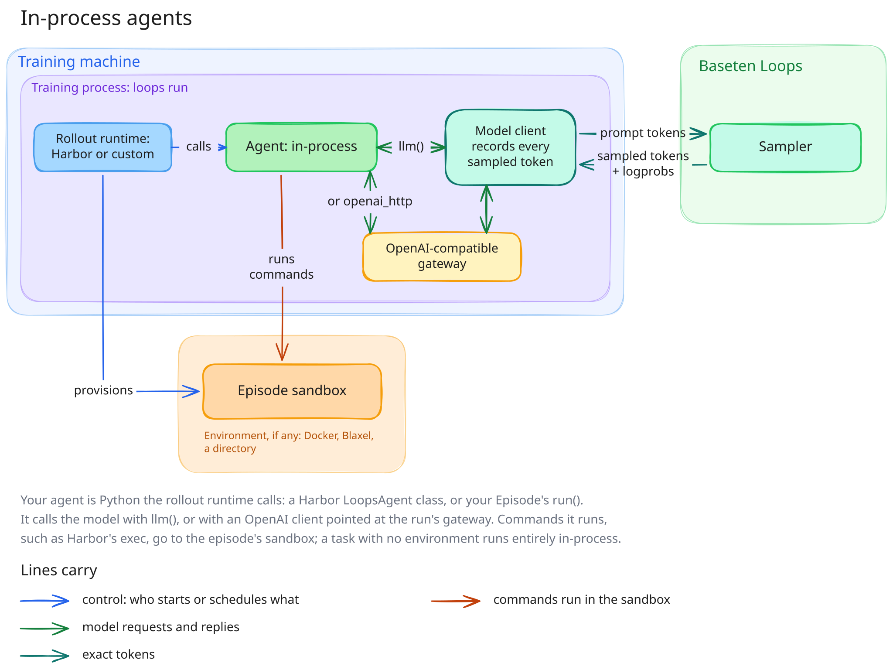
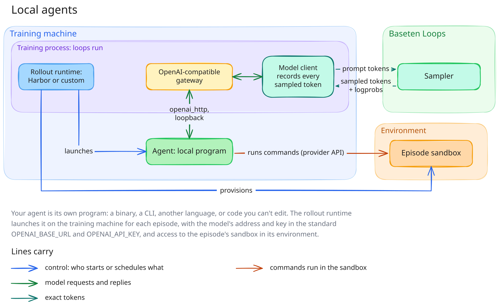
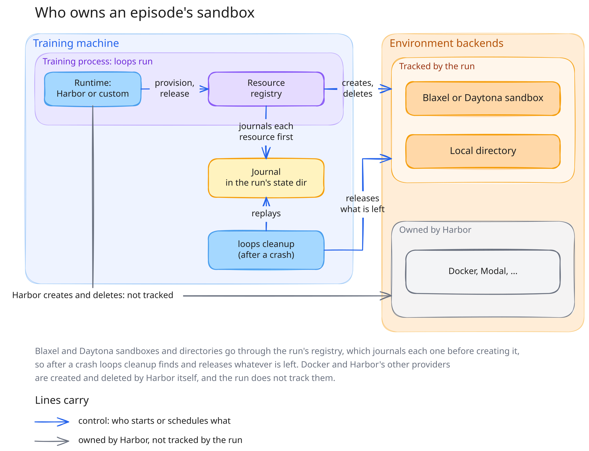

# Patterns

One directory per supported [pattern](#terms): a runtime, an agent
placement, and a model access. Each has `train.toml`, on the pattern's simplest backend
(no sandbox, a local directory, or Docker), and `train_blaxel.toml` on Blaxel. The
Harbor patterns all train one task and the custom runtimes all train one dataset, so
any two patterns of a runtime can be diffed. The two in-process patterns of a runtime
differ only in model access; a local pattern also changes a few sizes and limits:
Harbor's local pattern only `max_group_losses`; custom local `max_generation_tokens`,
plus the grading deadline in `train.toml` and concurrency in `train_blaxel.toml`, and
custom local on Blaxel sets no `max_rollout_retries`. Harbor's local pattern runs only
on Blaxel, so it has only `train_blaxel.toml`.

| Runtime | Agent placement | Model access | Directory | Backends |
| --- | --- | --- | --- | --- |
| Harbor | in-process | direct | [harbor/in_process_direct](harbor/in_process_direct/) | docker, blaxel |
| Harbor | in-process | openai_http | [harbor/in_process_openai_http](harbor/in_process_openai_http/) | docker, blaxel |
| Harbor | local | openai_http | [harbor/local](harbor/local/): its `LocalAgent` is the job entry that starts the program | blaxel |
| custom | in-process | direct | [custom_runtime/in_process_direct](custom_runtime/in_process_direct/) | none, blaxel |
| custom | in-process | openai_http | [custom_runtime/in_process_openai_http](custom_runtime/in_process_openai_http/) | none, blaxel |
| custom | local | openai_http | [custom_runtime/local](custom_runtime/local/) | dir, blaxel |

- The Harbor patterns train on the Harbor task [tasks/hill_climb](../tasks/hill_climb/).
  The custom runtimes train on one hidden answer to guess. The in-process ones use
  [tasks/hidden_answer_35b.jsonl](../tasks/hidden_answer_35b.jsonl), and
  [custom_runtime/local](custom_runtime/local/) uses
  [tasks/hidden_answer.jsonl](../tasks/hidden_answer.jsonl). The
  [tasks README](../tasks/README.md) says why there are two.
- [harbor/train_template.toml](harbor/train_template.toml) is a commented training
  config to copy next to your own Harbor job and agent.
- Each directory is self-contained apart from its task: copy it, then point
  `[runtime.files] tasks` or the job's `tasks:` at your own. The CLI makes the
  config's directory importable, so its modules need nothing else on the path.

Run any config from the repository root with `BASETEN_API_KEY` in `.env`:

```sh
uv run loops check patterns/<runtime>/<pattern>/train.toml   # launches nothing
uv run loops run   patterns/<runtime>/<pattern>/train.toml   # billable
```

Docker configs need a running Docker daemon. Blaxel configs need `BL_WORKSPACE` and
`BL_API_KEY` in `.env`, and `uv sync --extra harbor-blaxel` (Harbor) or
`uv sync --extra blaxel` (a custom runtime).

The runtime changes less than you might expect. Harbor and a custom runtime look the
same in every diagram below; only the runtime box changes, and with it what you
write.

A custom runtime is an `Episode[TaskModel, OptionsModel]` subclass: one object per
attempt, with `run(sample)` as the agent and `grade(grading)` to score it. The fixed
hooks receive `Setup`, `Sampling`, `Grading` and `Closing` records; only `Sampling`
provides the policy model. The cookbook runs the class as the
runtime (`loops_cookbook.episodes:create_runtime`): it loads and digests the tasks,
holds the attempt's capacity, provisions and releases its sandbox, enforces the agent
deadline, and calls `close(closing)` once. The direct pattern includes standalone
host and Blaxel Episode classes. `RolloutRuntime` is the layer
underneath, for a runtime that must hold capacity itself in its own way, as Harbor
does. See
[the Episode API](../docs/reference/episode-api.md).

<picture>
  <source media="(prefers-color-scheme: dark)" srcset="../docs/assets/core-loop-detailed-dark.svg">
  
</picture>

The diagrams below reuse its line colours.

## Terms

| Term | What it is | Today |
| --- | --- | --- |
| **Recipe** | The training method. | RL (GRPO, with advantages centred on the group mean and not scaled by its standard deviation), which every pattern here uses, or [SFT](../docs/reference/sft.md) on fixed data, which has no runtime or pattern. |
| **Runtime** | What produces episodes: it prepares tasks, runs each episode, and grades it. | [Harbor](https://github.com/laude-institute/harbor), or a custom runtime: your own `Episode` class, run by the cookbook. |
| **Agent placement** | Where the agent runs, relative to the training loop. | **in-process**, **local**, or **remote**: a distance from the training loop, below. |
| **Model access** | How the agent reaches the model. | **direct** (the cookbook's `llm()` client) or **openai_http** (an OpenAI-compatible endpoint the run serves). |
| **Environment backend** | Where an episode's environment, its sandbox, lives. | None, a local directory, Docker, Blaxel, Daytona, or another Harbor provider. |
| **Pattern** | A runtime, an agent placement, and a model access together. | [every pattern](#every-pattern) below. |
| **Settings** | Everything else, in `train.toml`. | Sync or async, trainable producers, model, limits: see the [knob glossary](../docs/reference/KNOB_GLOSSARY.md). |

## How to choose

Start from the agent you have:

- **It's Python you can call** (your own code, or a library you import): use an
  [in-process](#in-process-agents) agent.
- **It's a program you run** (a binary, a CLI, another language, or code you can't
  edit): use a [local](#local-agents) agent.
- **It has to live inside the sandbox** (an agent installed in the environment, such
  as OpenCode): that is a [remote](#remote-agents-not-supported-yet) agent, which is
  not supported yet.

Then pick the runtime: Harbor if your tasks are Harbor tasks, a custom runtime if they
are not (a gym-style environment, your own infrastructure).

## In-process agents

<picture>
  <source media="(prefers-color-scheme: dark)" srcset="../docs/assets/agents-in-process-dark.svg">
  
</picture>

Your agent is Python that the runtime calls inside the training process. It reaches
the model through the cookbook's model client, either directly with `llm()` or with an
OpenAI client pointed at the run's gateway. Commands it runs, such as Harbor's
`exec`, go to the episode's sandbox; a task with no environment runs entirely
in-process.

| Runtime | Model access | You write | Use it when |
| --- | --- | --- | --- |
| Harbor | direct | a `LoopsAgent` class that calls `llm()` | You have Harbor tasks and are writing the agent in Python. The simplest pattern: exact tokens, no extra hop. |
| Harbor | openai_http | a `LoopsAgent` class that hands the run's endpoint to an OpenAI client | You have Harbor tasks and a Python agent built on an OpenAI client, including one you import but don't own, such as a submodule. |
| custom | direct | an `Episode` whose `run()` calls `llm()` | Your tasks are not Harbor tasks and you are writing the episode logic in Python. |
| custom | openai_http | an `Episode` whose `run()` hands the run's endpoint to an OpenAI client | Your tasks are not Harbor tasks and your episode logic is Python built on an OpenAI client. |

## Local agents

<picture>
  <source media="(prefers-color-scheme: dark)" srcset="../docs/assets/agents-local-dark.svg">
  
</picture>

Your agent is its own program. The runtime launches it on the training machine for
each episode, with the model's address and key in the standard `OPENAI_BASE_URL` and
`OPENAI_API_KEY`, which OpenAI SDKs read unchanged, `OPENAI_MODEL` (the model name the
program must send), the task as `AGENT_INSTRUCTION`, and access to the episode's
sandbox in its environment. The program reaches the model over the run's loopback
gateway.

| Runtime | Model access | You write | Use it when |
| --- | --- | --- | --- |
| Harbor | openai_http | your program, unchanged, and a Harbor job entry that starts it | You have Harbor tasks and an agent that runs as its own program: a binary, a CLI, another language, or code you can't import or edit. |
| custom | openai_http | an `Episode` whose `run()` launches the agent program, with `sample.processes.run()` | Your tasks are not Harbor tasks and your agent runs as its own program, with your own sandboxes and verifier. |

Harbor's local pattern needs the sandbox's usage environment, which the cookbook's
Blaxel environment provides; Harbor's Docker environment does not, so there is no
Docker config.

## Remote agents (not supported yet)

The agent runs inside the episode's sandbox, such as one of Harbor's installed agents
(OpenCode, Codex, Claude Code, ...). Docker counts: a container's loopback is not the
training machine's. This is not supported yet, because the gateway has to be
reachable from the sandbox, and by default it listens only on the training machine's
loopback address.

| Runtime | Model access | You would write | Use it when |
| --- | --- | --- | --- |
| Harbor | openai_http | an agent installed in the sandbox | You have Harbor tasks and an agent that has to run inside the environment. |
| custom | openai_http | an `Episode` that starts the agent inside each episode's sandbox | Your tasks are not Harbor tasks and your agent has to run inside the environment. |

## Environment backends

<picture>
  <source media="(prefers-color-scheme: dark)" srcset="../docs/assets/backends-dark.svg">
  
</picture>

| Backend | Who creates and deletes it | After a crash | Used by |
| --- | --- | --- | --- |
| None | nothing to create | nothing to clean | the custom in-process patterns, `train.toml` |
| Local directory | the run, through an example provider (`local_sandbox.py`) | `loops cleanup` | [patterns/custom_runtime/local](custom_runtime/local/) `train.toml` |
| Docker (Harbor) | Harbor, not tracked by the run | Harbor stops containers when it shuts down; after a hard kill, check `docker ps` | every Harbor pattern's `train.toml` |
| Blaxel | the run, through its resource journal (`[providers.blaxel]`) | `loops cleanup` releases every sandbox | every `train_blaxel.toml` |
| Daytona | the run, through its resource journal (`[providers.daytona]`) | `loops cleanup` releases every sandbox | no pattern config; see [daytona.md](../docs/reference/daytona.md) |
| Other Harbor providers (Modal, E2B, ...) | Harbor, not tracked by the run | the provider's own TTL | untested |

A Blaxel-backed Harbor job must use the cookbook's environment class,
`loops_cookbook.harbor.blaxel:BlaxelEnvironment` (on Daytona,
`loops_cookbook.harbor.daytona:DaytonaEnvironment`). It is Harbor's own Blaxel
environment, except that every sandbox is created and released through the run, so
`loops cleanup` can account for it. The job names it with `environment.import_path`
alone: `type: blaxel` (or `type: daytona`) without `import_path` is refused, and beside it `type` is never
read, because Harbor builds the class `import_path` names.

## Every pattern

| Runtime | Agent placement | Model access | You write | Use it when |
| --- | --- | --- | --- | --- |
| Harbor | in-process | direct | a `LoopsAgent` class that calls `llm()` | You have Harbor tasks and are writing the agent in Python. The simplest pattern: exact tokens, no extra hop. |
| Harbor | in-process | openai_http | a `LoopsAgent` class that hands the run's endpoint to an OpenAI client | You have Harbor tasks and a Python agent built on an OpenAI client, including one you import but don't own, such as a submodule. |
| Harbor | local | openai_http | your program, unchanged, and a Harbor job entry that starts it | You have Harbor tasks and an agent that runs as its own program: a binary, a CLI, another language, or code you can't import or edit. |
| Harbor | remote | openai_http | an agent installed in the sandbox, such as OpenCode (not supported yet) | You have Harbor tasks and an agent that has to run inside the environment. |
| custom | in-process | direct | an `Episode` whose `run()` calls `llm()` | Your tasks are not Harbor tasks (a gym-style environment, your own infrastructure) and you are writing the episode logic in Python. |
| custom | in-process | openai_http | an `Episode` whose `run()` hands the run's endpoint to an OpenAI client | Your tasks are not Harbor tasks and your episode logic is Python built on an OpenAI client. |
| custom | local | openai_http | an `Episode` whose `run()` launches the agent program, with `sample.processes.run()` | Your tasks are not Harbor tasks and your agent runs as its own program, with your own sandboxes and verifier. |
| custom | remote | openai_http | an `Episode` that starts the agent inside each episode's sandbox (not supported yet) | Your tasks are not Harbor tasks and your agent has to run inside the environment. |

## Examples by setting

Each [example](../examples/) is a pattern above with settings or the task changed. The
critic, multi-step and Terminal-Bench ones build on Harbor's in-process direct pattern.

| Shows | Example |
| --- | --- |
| Async scheduling, up to two steps off-policy (a custom runtime, in-process, direct) | [async_scheduling](../examples/async_scheduling/) |
| One policy in two roles, both trained (`[rollout.producers]`) | [critic](../examples/critic/) |
| A multi-step task, each step verified in the agent's environment | [multi_step](../examples/multi_step/) |
| A real multi-turn dataset, on GLM-5.3-Flash through the cookbook's renderer extension | [terminal_bench](../examples/terminal_bench/) |
| An agent built on LiteLLM, streaming (a custom runtime, in-process, openai_http) | [litellm_streaming](../examples/litellm_streaming/) |
| A multi-turn agent with tools in a Blaxel sandbox, graded on what it left there (a custom runtime, in-process, direct) | [tool_agent](../examples/tool_agent/) |
| Group grading: an LLM judge ranks each group's answers (a custom runtime, in-process, direct) | [llm_judge](../examples/llm_judge/) |

The Harbor patterns and examples share their tasks, in [tasks/](../tasks/).

Images work in prompts and in tool results, in every pattern: see
[renderers.md](../docs/reference/renderers.md#images) for the shapes each model accepts.

The diagrams' sources are the `.excalidraw` files in [assets](../docs/assets/). To change
one, open it at [excalidraw.com](https://excalidraw.com), edit it, save it back, and
export it with "Embed scene" and the background on: in the light theme over
`<name>.svg`, and in the dark theme over `<name>-dark.svg`.
